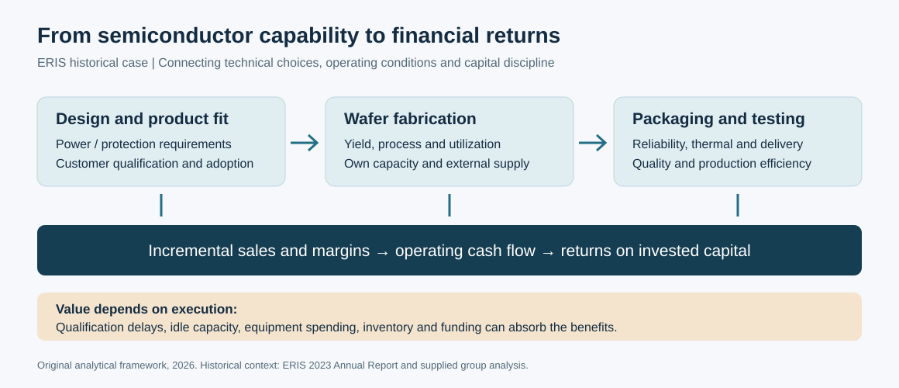
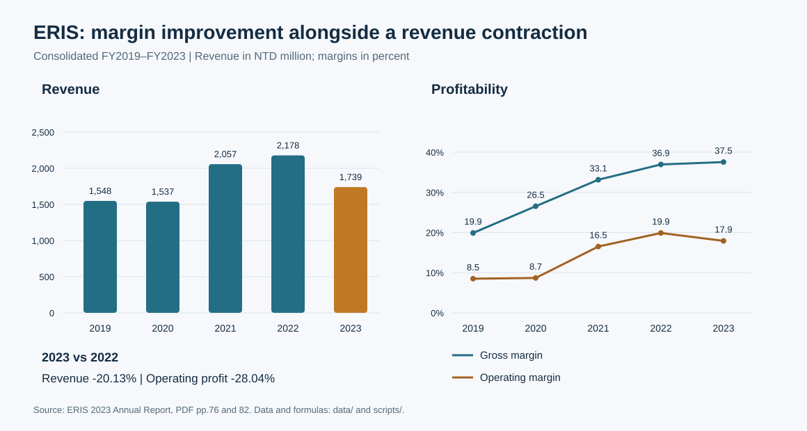

# ERIS Technology: Semiconductor Industry and Financial Analysis

### Connecting vertical integration, earnings quality and investment cash flow

[繁體中文](README.md) · [Industry analysis](docs/industry-analysis.zh-TW.md) · [Financial analysis](docs/financial-analysis.zh-TW.md) · [Capital budgeting](docs/capital-budgeting.zh-TW.md) · [Sources](docs/sources.md)

**Can upstream wafer integration translate demand from automotive, industrial and server applications into durable returns for a diode manufacturer?**

This historical case examines ERIS Technology (3675) through the power-semiconductor value chain, consolidated FY2019–FY2023 financial statements, working capital and capital budgeting. Eason jointly participated in the entire original Financial Management group analysis. The 2026 public edition adds source reconciliation, original visuals and reproducible calculations with AI assistance.



## Main findings

| Question | Evidence and interpretation |
|---|---|
| Does a better gross margin mean higher earnings? | FY2023 gross margin reached 37.54%, versus 36.94% in FY2022, while revenue fell 20.13% and operating profit fell 28.04%. Margin, scale and expense absorption need separate analysis. |
| How should technical investment and liquidity be assessed together? | R&D spending rose about 2.40%, but its revenue share rose to 7.96% partly because sales contracted. The current ratio was about 1.20x and quick ratio 0.96x. |
| Is a positive NPV enough to endorse the acquisition? | Re-discounting selected workbook cash-flow proxies gives NTD119,714 thousand; the presentation reports NTD175,229 thousand. Neither is a validated project valuation because cash-flow scope, capex, incrementality and WACC remain unresolved. |



The industry discussion distinguishes discrete power/protection devices from advanced logic, connects wafer integration to yield and utilization, and explains why foundry and discrete-device companies require different comparison baselines. The financial discussion separates pretax performance from tax benefits, consolidated profit from parent profit, accounting NWC from operating NWC, and total liabilities from financing debt.

Historical amounts were reconciled to the official 2023 annual report. The source-model diagnostic deliberately preserves selected original cached inputs. It does not recalculate the entire original workbook. Forecast labels retain the original 2024–2028 horizon and are not subsequent actual results.

## Reproduce

```bash
python3 scripts/reproduce_analysis.py
python3 scripts/reproduce_analysis.py --check
```

Python standard library only. Outputs include historical metrics, a source-model discounting diagnostic and 12 sensitivity combinations. The sensitivity inputs are illustrative diagnostics, not estimates of ERIS's actual WACC or project capex.

[Calculation report](outputs/analysis.md) · [Data definitions](data/README.md) · [Model review](docs/model-review.md) · [Attribution](docs/contribution.md)

Original group PDFs, student identifiers, the full workbook and hidden example tabs are excluded from the public repository. No corporate implementation, realized synergy or investment recommendation is claimed. [Notice](NOTICE.md)
