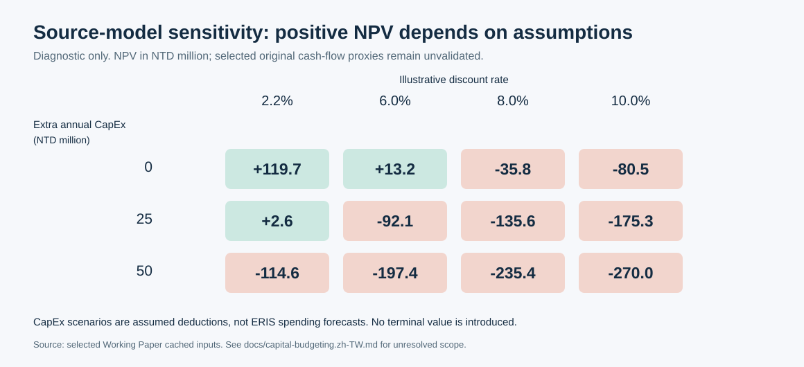

# 資本預算：把產業假設變成增量現金流

[首頁](../README.md) · [模型審閱](model-review.md) · [敏感度資料](../outputs/npv-sensitivity.csv)

## 決策問題與反事實

原作問的是基隆晶圓製造業務整合能否帶來投資價值。嚴謹的模型應比較「有專案」與「無專案」兩條路徑，而非直接取整家公司營收乘上車用應用占比。

例如，新增車用收入可能同時來自原有客戶、產業需求、不同併購或新產品；應用占比增加也可能只是其他應用收入下降。若未建立反事實，無法把其全部歸因於這項投資。

## 專案 FCFF 架構

```text
增量 EBIT = 有專案 EBIT − 無專案 EBIT
增量 FCFF = 增量 EBIT × (1 − 正常化稅率)
          + 增量折舊攤銷
          − 增量資本支出
          − 增量營業性淨營運資金

NPV = − 初始淨投入
      + Σ[增量 FCFF_t / (1 + 專案 WACC)^t]
      + 期末淨回收現值（若有依據）
```

此為正常化稅務的簡化架構。實際現金稅、虧損扣抵、整合費用與交易稅務需另建明細。初始投入包含實際交易現金、必要初始支出與營運資金，避免與後續年度重複扣除。若採企業自由現金流，應避免淨利中已扣利息後又使用 WACC；股東現金流則須搭配權益成本與融資變動。

期末回收可包含處分淨值及營運資金回收，但須有可辯護的假設；永續價值亦需穩定期再投資條件。原作沒有足夠專案資料，本版不補造殘值或宣稱完整估值。

## WACC 的重建順序

1. 決定估值日、幣別、名目／實質及現金流風險範圍。
2. `Ke = Rf + Beta × ERP`：說明無風險利率期限、風險溢酬來源，並以德微或合理可比公司的同期間報酬估 Beta。
3. 估計新增／再融資的邊際 `Kd`，使用可適用的正常化稅盾。
4. 以一致的市場價值／目標資本結構計算 `WACC = E/(D+E) × Ke + D/(D+E) × Kd × (1−T)`。
5. 分析認證延期、稼動率、良率及價格風險是否已在現金流內處理，避免重複扣風險。

原工作表的 Beta 參考頁是寶雅資料，不能當成德微估計值。簡報另有 Beta 圖，但沒有底層報酬序列可獨立重估。Working Paper 的 2.2% 是固定輸入，未由其空白成本欄推導，因此本版不宣稱已重建真實 WACC。

## 來源模型折現診斷

本版僅重新折現原工作簿選定的**已保存現金流代理值**：108,487.5356、156,034.5240、202,638.0165、233,508.3388、290,219.5944（仟元），期數 1–5，以 2.2% 折現並扣 800,000，得到約 **119,714**。

這核對了選定輸入的折現算術，未完整執行原工作簿，亦未確認各數字是專案增量 FCFF。簡報 pp.60–61 的 175,229 來自不同未對齊版本，不能與本工作簿混用。



敏感度以原代理值為起點，改變折現率 **2.2%、6%、8%、10%**，並每年另扣 **0、25,000、50,000 仟元**。後兩組是刻意設定的診斷假設，不是公司資本支出預測；各替代折現率也不是本版估計的 WACC。它展示原正 NPV 對輸入的敏感性，沒有解決增量歸屬與現金流範圍問題。

## 形成投資結論前所需資料

| 必要資料 | 對應判斷 |
|---|---|
| 最終成交價、承接負債、交易及整合現金支出 | 初始投入與重複計算 |
| 基準／專案銷量、單價、良率及產能利用路徑 | 可歸因的增量收入與成本 |
| 設備與維持性支出、折舊及正常化稅務 | FCFF 與再投資能力 |
| 營業應收、存貨、應付及付款條件 | 增量營業性營運資金 |
| 市場價值、付息債務及相符報酬序列 | 專案折現率 |
| 期末使用、處分與營運資金回收安排 | 五年之外的價值與成本 |

本案能支持的是**策略理由與投資驗證框架**，尚無足夠資料支持真實收購案應否投資的結論。
